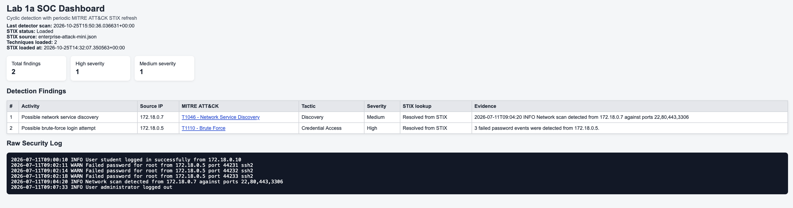

# Lab 1a Report - SOC Detection & MITRE ATT&CK Mapping

**Students:**  
Roy Tevel - 315144634  
Lior Levin - 207691148  
**Date:** 2026-10-25  
**Duration:** 60 minutes  

---

## 1. Docker Verification & Dashboard Screenshot

Services started successfully using:
```
docker compose up --build -d
```

Dashboard available at: http://localhost:8000  
STIX source: enterprise-attack-mini.json (2 techniques loaded)  
Last detector scan: 2026-10-25T15:45:39

**Initial finding count from clean baseline: 2**
- 1 High severity finding (T1110 - Brute Force)
- 1 Medium severity finding (T1046 - Network Service Discovery)



---

## 2. Evidence → Rule → Technique → Tactic Table

| | T1110 - Brute Force | T1046 - Network Service Discovery |
|---|---|---|
| **Raw Evidence** | 3 lines: "Failed password for root from 172.18.0.5" | 1 line: "Network scan detected from 172.18.0.7 against ports 22,80,443,3306" |
| **Detection Rule** | Count "Failed password" lines per source IP; if count ≥ 3 → finding | If line contains "network scan detected" → finding |
| **MITRE Technique** | T1110 | T1046 |
| **Tactic** | Credential Access | Discovery |
| **Uncertainty** | Rule has no time window; 3 failures could be legitimate (typos, forgotten password). Does not confirm successful access. | Rule relies on explicit text in log, not actual packet analysis. Could be triggered by a false or injected log line. |

---

## 3. Controlled Experiments C1–C4

### C1 - Below the threshold
- **Change:** Deleted one "Failed password" line from 172.18.0.5 (2 remaining instead of 3)
- **Predicted:** T1110 disappears
- **Actual:** T1110 disappeared, T1046 remained
- **Explanation:** The detector threshold is 3. With only 2 failures, the rule is not triggered.

### C2 - Three failures from three different IPs
- **Change:** Changed each "Failed password" line to use a different source IP (172.18.0.5, 172.18.0.6, 172.18.0.8)
- **Predicted:** No T1110 finding
- **Actual:** T1110 disappeared completely
- **Explanation:** The detector groups failures by source IP. Each IP had only 1 failure — none crossed the threshold of 3.

### C3 - Threshold crossing from new IP
- **Change:** Added 3 "Failed password" lines from new IP 192.0.2.55
- **Predicted:** New T1110 finding for 192.0.2.55
- **Actual:** Two T1110 findings appeared — one for 172.18.0.5 (original) and one for 192.0.2.55 (new)
- **Explanation:** Each IP that reaches 3+ failures gets its own finding.

### C4 - Second network scan record
- **Change:** Added a "Network scan detected from 192.0.2.77" line
- **Predicted:** Second T1046 finding
- **Actual:** Two T1046 findings appeared — one for 172.18.0.7 and one for 192.0.2.77
- **Explanation:** Each line containing "network scan detected" triggers a separate finding, regardless of IP.

---

## 4. Simulator Observation

When the simulator was running, multiple new source IPs appeared (172.18.0.21, 172.18.0.22, 172.18.0.31, 172.18.0.32, 172.18.0.33, 172.18.0.58) generating both T1110 and T1046 findings, causing the total finding count to grow over time and making results non-reproducible — unlike the controlled manual experiments.

---

## 5. SOC Narrative (100–150 words)

At 09:02, three consecutive failed SSH login attempts were recorded from source IP 172.18.0.5 targeting the root account. The rule-based detector flagged this activity as a candidate Brute Force attempt (T1110, Credential Access) with High severity. At 09:04, a network scan was detected from 172.18.0.7 targeting ports 22, 80, 443, and 3306, triggering a candidate Network Service Discovery finding (T1046, Discovery) with Medium severity.

It is important to note that these findings represent observed behavior consistent with known attack techniques — they do not confirm malicious intent, attacker identity, or successful compromise. The brute-force rule has no time window and could be triggered by legitimate repeated login failures. The scan detection relies on explicit log text rather than raw packet analysis. Both findings require further investigation before escalation.
